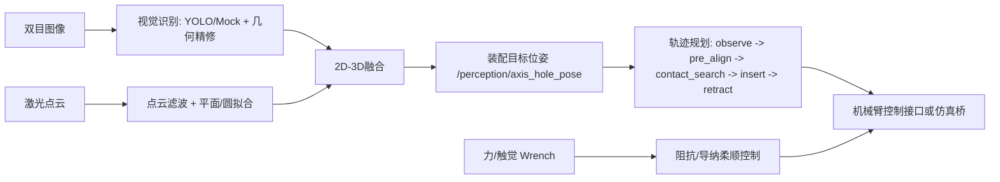

# ros2机械臂装配智能体

面向机械臂轴孔装配、插接和柔顺定位的 ROS 2 应用。项目已把原文件夹中的双目视觉、激光点云、CoppeliaSim/UR5 轨迹原型、OpenMV/Arduino 视觉实验和力控导纳原型整理为三个工程模块：

1. 视觉识别
2. 轨迹规划
3. 力触觉多模态感知与阻抗伺服驱动的柔顺反馈控制

当前 release 以模拟数据闭环为主：无需真实相机、激光扫描仪或力传感器即可跑通“识别孔位 -> 生成装配轨迹 -> 输出柔顺伺服修正”的应用链路。真实硬件接入点保留在配置文件、话题和 reference 原型中。

## 快速运行

```bash
cd ros2_arm_assembly_agent
colcon build --symlink-install
source install/setup.bash

# 一键启动三大模块的模拟应用
ros2 launch axis_hole_bringup assembly_agent_demo.launch.py

# 可选: 打开 RViz
ros2 launch axis_hole_bringup assembly_agent_demo.launch.py use_rviz:=true
```

关键输出：

```bash
ros2 topic echo /perception/axis_hole_pose --once
ros2 topic echo /assembly/trajectory_plan --once
ros2 topic echo /assembly/compliant_twist --once
ros2 topic echo /assembly/contact_state --once
```

## 三大模块

| 模块 | ROS 2 包 | 输入 | 输出 | 来源材料 |
|---|---|---|---|---|
| 视觉识别 | `stereo_hole_detector`, `laser_pointcloud_processor`, `axis_hole_fusion`, `axis_hole_interfaces` | 双目图像、激光点云 | `Hole2DArray`, `AxisHole3D`, `PoseStamped` | `claude_code` 中轴孔感知工程、OpenCV椭圆拟合、相机/手眼标定脚本 |
| 轨迹规划 | `assembly_trajectory_planner` | `/perception/axis_hole_pose` | `/assembly/trajectory_plan`, `/assembly/trajectory_path` | CoppeliaSim、UR5、peg-in-hole 观测/对准/插入原型 |
| 柔顺反馈控制 | `compliant_servo_control` | `/force_torque/wrench` | `/assembly/compliant_twist`, `/assembly/contact_state` | UR5导纳控制、力传感插入、视觉-力融合装配原型 |

## 应用数据流



## 目录结构

```text
ros2_arm_assembly_agent/
├── src/
│   ├── axis_hole_interfaces/          # 孔洞识别自定义消息
│   ├── stereo_hole_detector/          # 双目/单目图像孔洞检测
│   ├── laser_pointcloud_processor/    # 激光点云滤波、平面拟合、圆拟合
│   ├── axis_hole_fusion/              # 2D-3D融合和TF坐标转换
│   ├── assembly_trajectory_planner/   # 新增: 装配轨迹规划
│   ├── compliant_servo_control/       # 新增: 力触觉柔顺反馈控制
│   ├── demo_data/                     # 模拟图像/点云发布器
│   ├── calibration_manager/           # 标定框架
│   └── axis_hole_bringup/             # 一键启动入口和RViz配置
├── modules/                           # 三大模块说明
├── reference/                         # 从原文件夹整理出的历史原型
├── docs/                              # 架构、接口、实验和路线图
├── scripts/                           # 模拟数据生成脚本
└── release/                           # 本地release产物输出目录
```

## 主要话题

| 话题 | 类型 | 说明 |
|---|---|---|
| `/stereo/left/image_raw` | `sensor_msgs/Image` | 左目图像 |
| `/laser/pointcloud_raw` | `sensor_msgs/PointCloud2` | 原始激光点云 |
| `/perception/holes_2d` | `axis_hole_interfaces/Hole2DArray` | 2D孔洞检测结果 |
| `/perception/axis_hole_3d_fused` | `axis_hole_interfaces/AxisHole3D` | 融合后的3D孔位 |
| `/perception/axis_hole_pose` | `geometry_msgs/PoseStamped` | robot_base下的装配目标 |
| `/assembly/trajectory_plan` | `geometry_msgs/PoseArray` | 装配阶段位姿序列 |
| `/assembly/trajectory_path` | `nav_msgs/Path` | 可视化路径 |
| `/force_torque/wrench` | `geometry_msgs/WrenchStamped` | 力/力矩输入 |
| `/assembly/compliant_twist` | `geometry_msgs/TwistStamped` | 柔顺伺服修正速度 |
| `/assembly/contact_state` | `std_msgs/Bool` | 接触状态 |

## 安装依赖

推荐在 WSL2 Ubuntu + ROS 2 Humble/Iron/Jazzy 中运行。

```bash
sudo apt install python3-colcon-common-extensions
sudo apt install ros-${ROS_DISTRO}-cv-bridge \
                 ros-${ROS_DISTRO}-tf2-ros \
                 ros-${ROS_DISTRO}-tf2-geometry-msgs \
                 ros-${ROS_DISTRO}-rviz2

pip install numpy opencv-python pyyaml scipy
# 可选: 点云/YOLO真实推理
pip install open3d ultralytics
```

## 测试

```bash
python src/stereo_hole_detector/test/test_geometry_refiner.py
python src/laser_pointcloud_processor/test/test_circle_fitter.py
python src/axis_hole_fusion/test/test_coordinate_transformer.py
python -m pytest src/assembly_trajectory_planner/test src/compliant_servo_control/test
```

## 硬件接入位置

- 真实双目相机：替换 `/stereo/left/image_raw`、`/stereo/right/image_raw` 和 `camera_info` 发布源。
- 真实激光/结构光点云：发布到 `/laser/pointcloud_raw`，并更新 `laser_pointcloud_processor/config/*.yaml`。
- MoveIt 2 或 ros2_control：订阅 `/assembly/trajectory_plan` 和 `/assembly/compliant_twist`，接入实际机械臂控制器。
- 六维力传感器或触觉阵列：发布 `geometry_msgs/WrenchStamped` 到 `/force_torque/wrench`。

## Release 内容

本版本整理为应用包 `ros2机械臂装配智能体 v0.1.0`：

- 已完成三大模块重组。
- 新增 `assembly_trajectory_planner` ROS 2 包。
- 新增 `compliant_servo_control` ROS 2 包。
- 新增总启动文件 `axis_hole_bringup/launch/assembly_agent_demo.launch.py`。
- 将历史原型归档到 `reference/`，保留可追溯依据。

详见 [release/RELEASE_NOTES.md](release/RELEASE_NOTES.md)。
